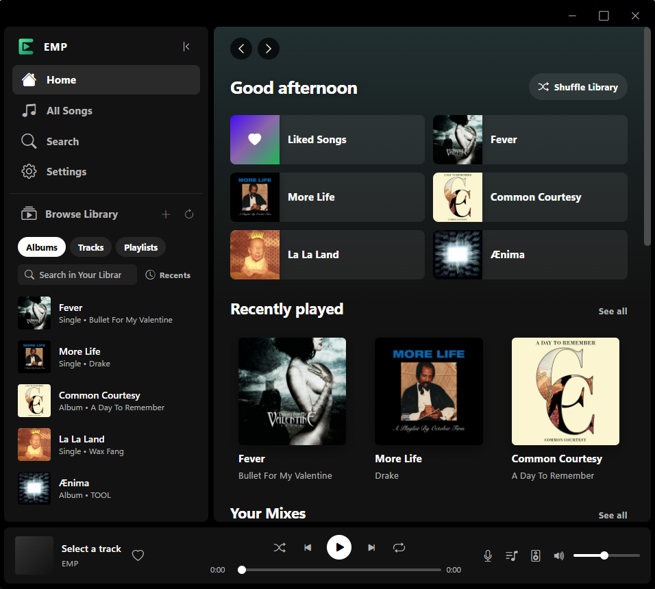
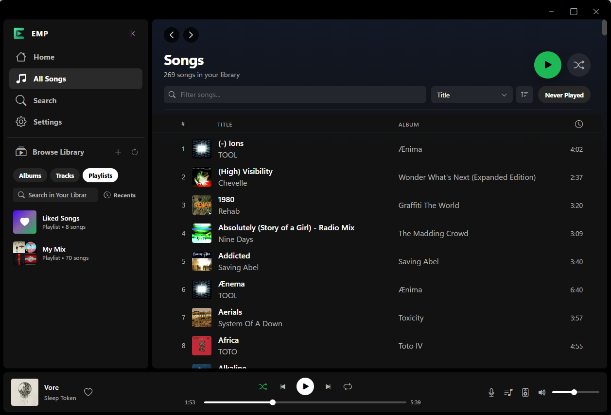
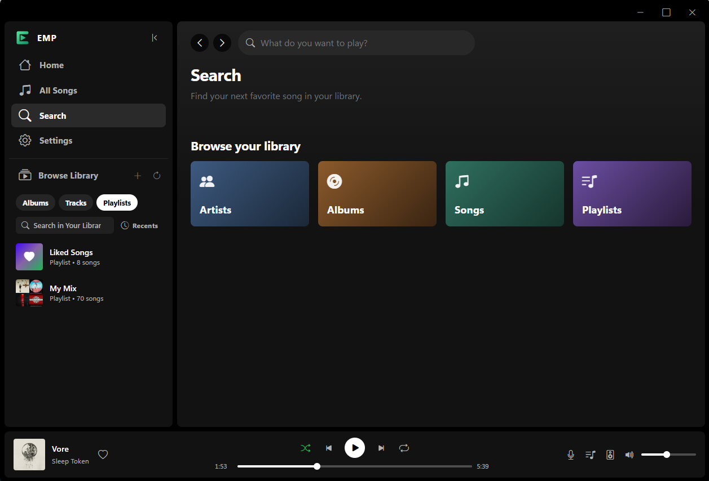
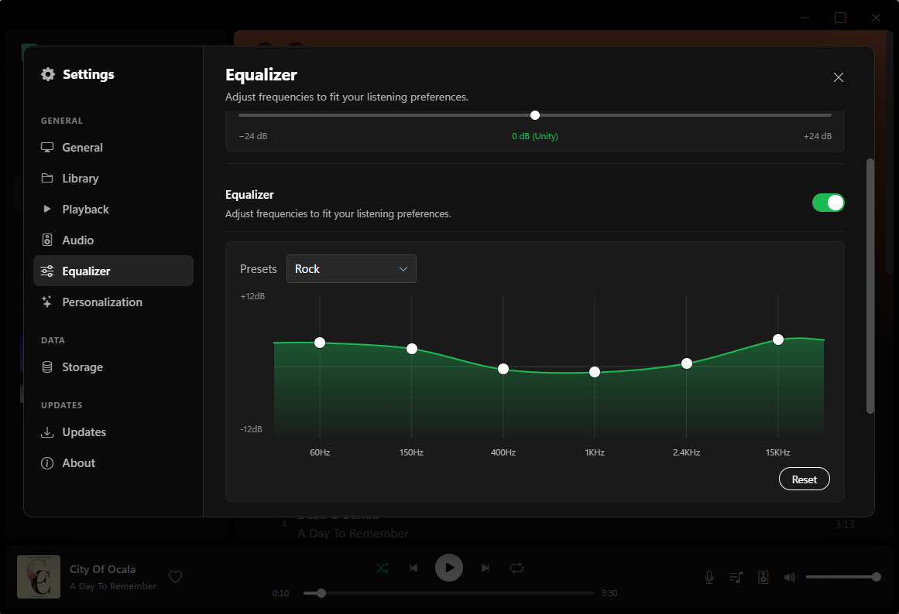
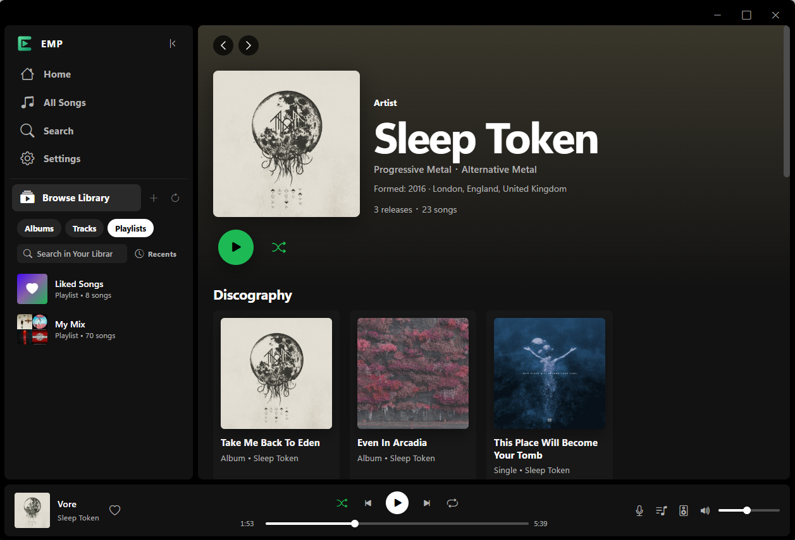
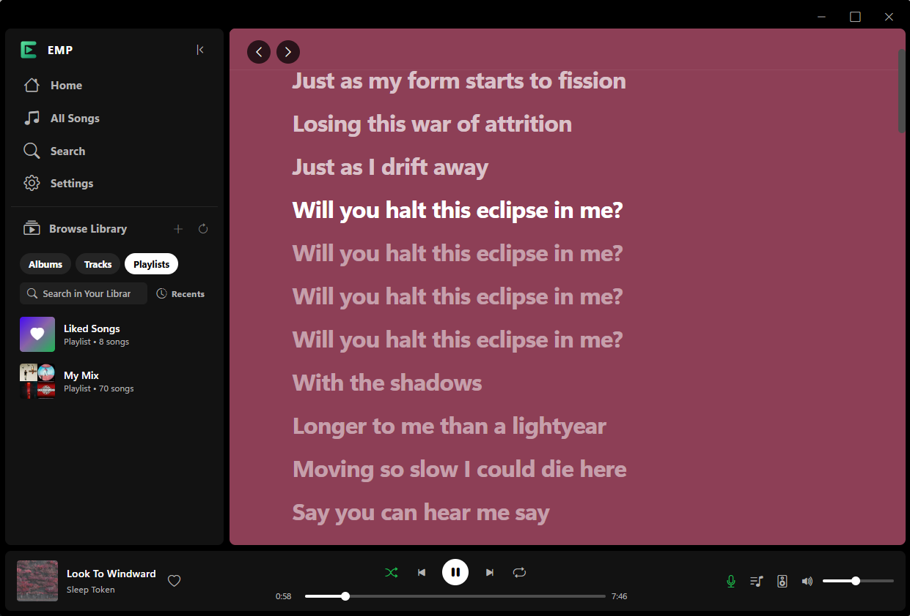

 <p align="center">
  
</p>

<h1 align="center">EMP</h1>

<p align="center">
  A modern Windows music player built around the music you already own.<br>
  Streaming-style experience. Native audio playback. No account required.
</p>

<p align="center">
  <a href="https://github.com/lazytitanz/EMP/releases/latest"></a>
  <a href="https://github.com/lazytitanz/EMP/releases"></a>
  
  <a href="https://github.com/lazytitanz/EMP/commits/main"></a>
</p>

<p align="center">
  <a href="#download">Download</a> ·
  <a href="#features">Features</a> ·
  <a href="#audio-powered-by-sonora">Audio</a> ·
  <a href="#screenshots">Screenshots</a> ·
  <a href="#why-emp">Why EMP?</a> ·
  <a href="#build-from-source">Build</a>
</p>

<p align="center">
  
</p>

EMP turns your personal music folders into a polished desktop listening experience — complete with playlists, smart playlists, personalized mixes, lyrics, metadata editing, and Cast/DLNA.

Local playback is powered by [Sonora](https://github.com/lazytitanz/Sonora), an open-source .NET audio engine built for native Windows audio output and real-time audio processing.

No streaming subscription. No account. Just your music.

## Download

**[Download the latest release →](https://github.com/lazytitanz/EMP/releases/latest)**

1. Download the Windows release archive.
2. Extract it anywhere.
3. Run **EMP.exe** — no installer required.

### Quick start

1. Add one or more music folders when prompted (or later in **Settings**).
2. Wait for EMP to scan and organize your library.
3. Play from Home, Search, or your library — then build playlists and mixes as you go.

> [!NOTE]
> EMP is in early development and improving quickly. You may encounter rough edges. Bug reports through [GitHub Issues](https://github.com/lazytitanz/EMP/issues) are welcome.

## Features

| | What you get |
|---|---|
| **Your library** | Albums, artists, singles, playlists, and Liked Songs — scanned from your folders and kept up to date |
| **Smart playlists** | Rule-based playlists with live preview, templates, sorting, and limits |
| **Your Mixes** | Heavy Rotation, Rediscover, Library Discovery, and artist mixes based on your listening history |
| **Search** | Dedicated search with ranked results, top matches, and browse shortcuts |
| **Native playback** | Sonora-powered audio with WASAPI output, Shared/Exclusive modes, and output-device selection |
| **Audio processing** | Six-band equalizer, presets, preamp, limiter, ReplayGain, crossfade, and gapless playback |
| **Playback controls** | Queue, shuffle, repeat, session restore, Windows media controls, and taskbar integration |
| **Lyrics** | Synced lyrics with active-line highlighting, plain lyrics fallback, and local caching |
| **Metadata** | Edit tags and artwork in-app, including batch edits with preview |
| **Connect** | Google Cast and DLNA/UPnP — original files streamed from your PC over the local network |
| **Updates** | Optional checks through GitHub Releases; you decide when to install |

**Supported audio formats:** MP3, M4A, AAC, FLAC, WAV, OGG, Opus, WMA, AIFF, ALAC, and WebM (audio-only).

Format compatibility can depend on the codec and container used by an individual file.

<details>
<summary><strong>Library details</strong></summary>

- Grid and list layouts for library and playlists
- Recently played and quick picks
- Create, edit, and delete regular playlists
- Optional artist information from MusicBrainz
- Artwork-driven colors throughout the interface

</details>

<details>
<summary><strong>Smart playlist details</strong></summary>

- Create from the sidebar **+** menu
- Visual rule editor with Match all / Match any and nested groups
- Conditions for metadata, play count, last played, never played, date added, favorites, and more
- Templates such as Recently Added, Never Played, Most Played, Forgotten Favorites, and Recently Played
- Edit rules, refresh matches, duplicate, convert to a regular playlist, or delete

</details>

## Audio powered by Sonora

EMP uses [Sonora](https://github.com/lazytitanz/Sonora), an independently developed, open-source .NET audio engine, for local music playback.

Rather than relying on Chromium's audio playback pipeline, EMP uses Sonora to decode and process audio and deliver it to Windows audio devices through WASAPI.

### Native Windows audio

- **WASAPI Shared mode** — plays alongside audio from other applications.
- **WASAPI Exclusive mode** — requests dedicated access to a supported output device.
- **Output device selection** — choose where your music plays.
- **Device handling** — respond to output-device changes and disconnections.

### Audio processing

- **Six-band equalizer** — adjust frequencies using an interactive EQ graph and built-in presets.
- **Preamp** — control gain before output.
- **Limiter** — reduce peaks that could cause clipping.
- **ReplayGain** — normalize playback levels using embedded Track or Album gain metadata.
- **Crossfade** — blend transitions between songs.
- **Gapless playback** — reduce interruptions between consecutive tracks through Sonora's preloaded track transitions.

These settings are available through EMP's dedicated Playback, Audio, and Equalizer settings pages.

### Local playback, separate from casting

Sonora handles playback on your Windows PC.

When using Google Cast or DLNA/UPnP, EMP serves the original audio file from your computer over the local network. Files are not uploaded to a cloud service or transcoded by EMP.

Local audio processing — including EQ, ReplayGain, limiter, preamp, crossfade, and gapless transitions — is not applied to the original file sent to a casting device.

Sonora is also available as a standalone open-source project for developers building .NET audio applications.

**[Explore Sonora on GitHub →](https://github.com/lazytitanz/Sonora)**

## Screenshots

<p align="center">
  
</p>
<p align="center"><em>All Songs — jump right into your music library.</em></p>

<p align="center">
  
</p>
<p align="center"><em>Search — find tracks, albums, artists, and playlists.</em></p>

<p align="center">
  
</p>
<p align="center"><em>Settings — customize playback, audio output, equalizer, and more.</em></p>

<p align="center">
  
</p>
<p align="center"><em>Artists — explore your library and discographies.</em></p>

<p align="center">
  
</p>
<p align="center"><em>Lyrics — follow along with synced or plain lyrics.</em></p>

## Why EMP?

EMP is for people who keep their own music collection but still want a modern desktop music app.

There's no streaming catalog to subscribe to and no account required to listen. Choose your music folders and EMP builds the experience around your collection.

With Sonora powering local playback, EMP combines a modern music-library interface with a native Windows audio engine and configurable audio processing.

**The goal is simple: make a local music library feel as polished and convenient as a modern streaming app.**

## Build from source

Requires the [.NET 10 SDK](https://dotnet.microsoft.com/download) on Windows 10 or later.

```bash
git clone https://github.com/lazytitanz/EMP.git
cd EMP
dotnet run --project EMP
```

If building from a development branch that references Sonora as a local project, the corresponding Sonora source checkout may also be required.

## Contributing

Ideas, bug reports, and pull requests are welcome.

- [Open an issue](https://github.com/lazytitanz/EMP/issues)
- [Start a discussion](https://github.com/lazytitanz/EMP/discussions)

For issues specifically involving Sonora's audio engine, see the [Sonora repository](https://github.com/lazytitanz/Sonora).