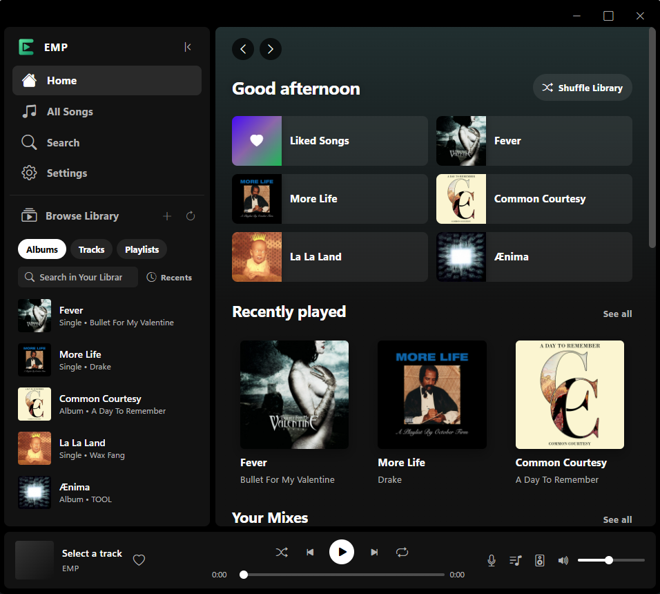
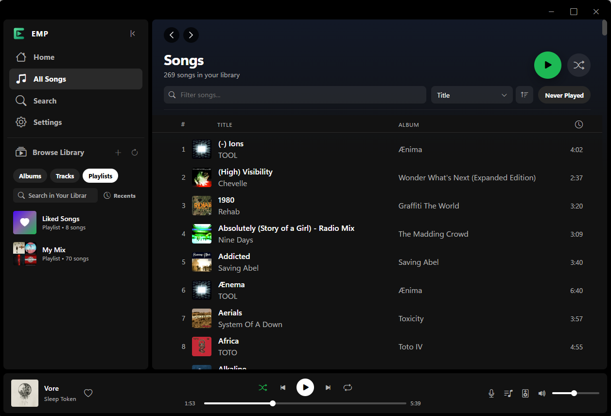
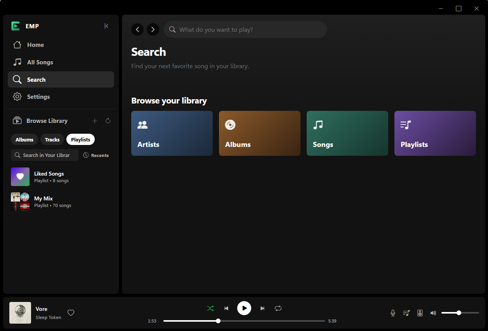
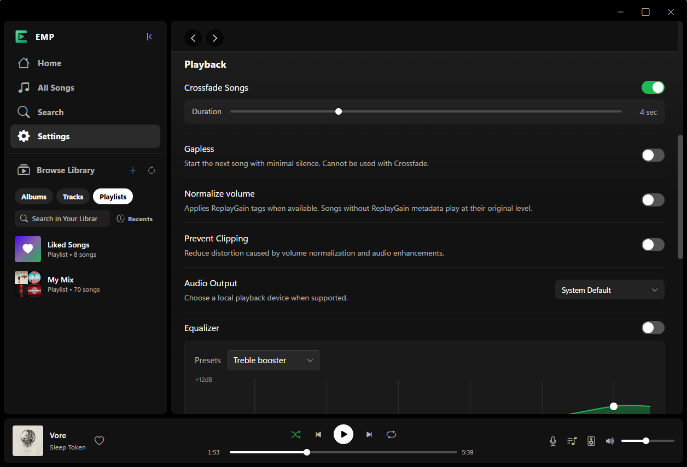
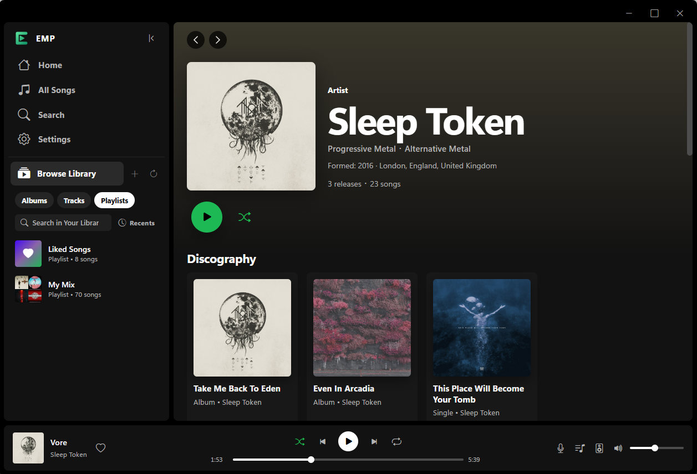
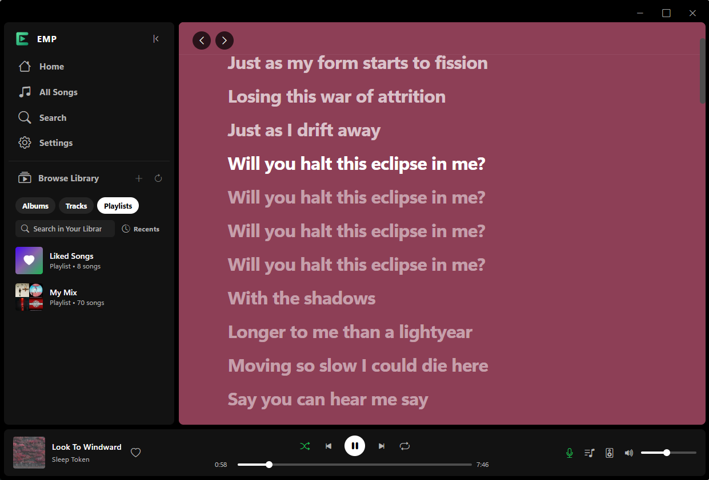

<p align="center">
  
</p>

<h1 align="center">EMP</h1>

<p align="center">
  A modern Windows music player built around the music you already own.<br>
  Streaming-style experience. Local files. No account required.
</p>

<p align="center">
  <a href="https://github.com/lazytitanz/EMP/releases/latest"></a>
  <a href="https://github.com/lazytitanz/EMP/releases"></a>
  
  <a href="https://github.com/lazytitanz/EMP/commits/main"></a>
</p>

<p align="center">
  <a href="#download">Download</a> ·
  <a href="#features">Features</a> ·
  <a href="#screenshots">Screenshots</a> ·
  <a href="#why-emp">Why EMP?</a> ·
  <a href="#build-from-source">Build</a>
</p>

<p align="center">
  
</p>

EMP turns your personal music folders into a polished desktop listening app — library, playlists, smart playlists, personalized mixes, lyrics, metadata editing, and Cast/DLNA — without a streaming subscription or sign-in.

## Download

**[Download the latest release →](https://github.com/lazytitanz/EMP/releases/latest)**

1. Download the Windows release archive
2. Extract it anywhere
3. Run **EMP.exe** — no installer required

### Quick start

1. Add one or more music folders when prompted (or later in **Settings**)
2. Wait for EMP to scan and organize your library
3. Play from Home, Search, or your library — then build playlists and mixes as you go

> [!NOTE]
> EMP is in early development and improving quickly. You may hit rough edges — bug reports via [Issues](https://github.com/lazytitanz/EMP/issues) are welcome.

## Features

| | What you get |
|---|---|
| **Your library** | Albums, artists, singles, playlists, Liked Songs — scanned from your folders and kept up to date as files change |
| **Smart playlists** | Rule-based playlists with live preview, templates, sorting, and limits |
| **Your Mixes** | Heavy Rotation, Rediscover, Library Discovery, and artist mixes from your listening history — no recommendation service |
| **Search** | Dedicated search with top result, ranked matches, and browse shortcuts |
| **Playback** | Queue, shuffle/repeat, crossfade or gapless, ReplayGain, equalizer, output device, Windows media & taskbar controls |
| **Lyrics** | Synced lyrics with active-line highlighting, plain lyrics fallback, and local caching |
| **Metadata** | Edit tags and artwork in-app, including batch edits with preview |
| **Connect** | Google Cast and DLNA/UPnP — original files streamed from your PC on the local network |
| **Updates** | Optional checks from GitHub Releases; you choose when to install |

Supported formats: **MP3, M4A, AAC, FLAC, WAV, OGG, Opus, WMA, AIFF, ALAC**.

<details>
<summary><strong>Library details</strong></summary>

- Grid and list layouts for library and playlists
- Recently played and quick picks
- Create, edit, and delete regular playlists
- Optional artist information from MusicBrainz
- Artwork-driven colors throughout the interface
</details>

<details>
<summary><strong>Smart playlist details</strong></summary>

- Create from the sidebar **+** menu
- Visual rule editor with Match all / Match any and nested groups
- Conditions for metadata, play count, last played, never played, date added, favorites, and more
- Templates such as Recently Added, Never Played, Most Played, Forgotten Favorites, and Recently Played
- Edit rules, refresh matches, duplicate, convert to a regular playlist, or delete
</details>

<details>
<summary><strong>Playback & audio details</strong></summary>

- Session restore for queue, track, and position
- ReplayGain Track or Album mode when tags are available
- Prevent clipping to reduce distortion from normalization and enhancements
- Equalizer with presets
</details>

<details>
<summary><strong>Casting notes</strong></summary>

Open **Connect to a device** from the player bar. When casting, EMP serves the original audio file from your PC — nothing is uploaded or transcoded.

Audio processing (equalizer, ReplayGain, prevent clipping, crossfade, gapless) applies on this computer and is not applied when sending the original file to another device.
</details>

## Screenshots

<p align="center">
  
</p>
<p align="center"><em>All Songs — jump right in to listening to every song in your library.</em></p>

<p align="center">
  
</p>
<p align="center"><em>Search page.</em></p>

<p align="center">
  
</p>
<p align="center"><em>Settings page.</em></p>

<p align="center">
  
</p>
<p align="center"><em>Artists page and discography sections.</em></p>

<p align="center">
  
</p>
<p align="center"><em>Lyrics panel.</em></p>

## Why EMP?

EMP is for people who keep their own music collection but still want a modern desktop music app.

There's no streaming catalog to subscribe to and no account required to listen. Choose your music folders and EMP builds the experience around your collection.

**The goal is simple: make a local music library feel as polished and convenient as a modern streaming app.**

## Build from source

Requires [.NET 10 SDK](https://dotnet.microsoft.com/download) on Windows 10 or later.

```bash
git clone https://github.com/lazytitanz/EMP.git
cd EMP
dotnet run --project EMP
```

## Contributing

Ideas, bugs, and pull requests are welcome.

- [Open an issue](https://github.com/lazytitanz/EMP/issues)
- [Start a discussion](https://github.com/lazytitanz/EMP/discussions)
